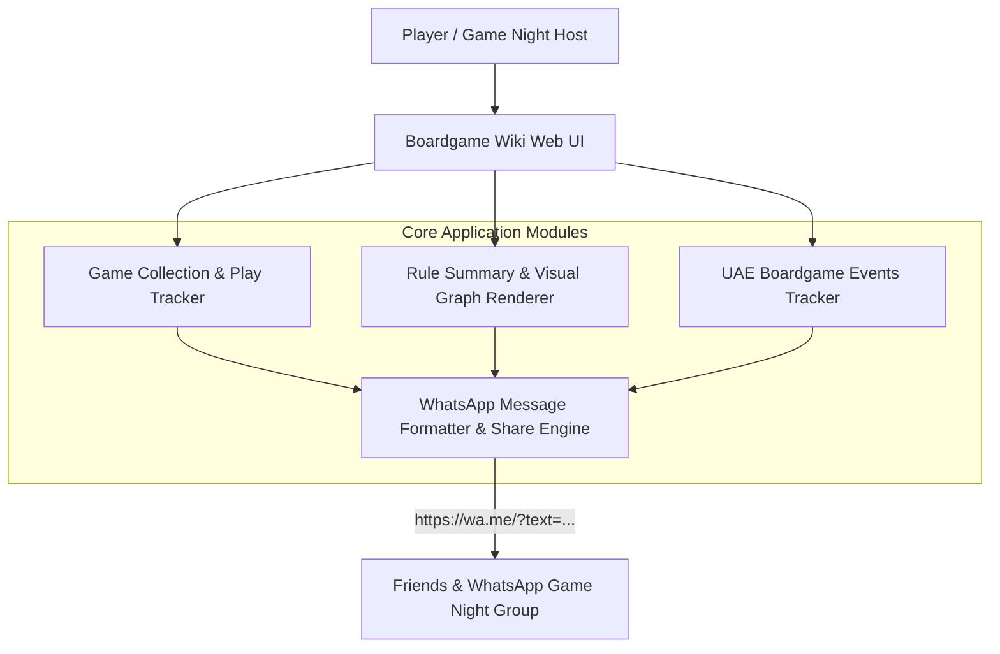
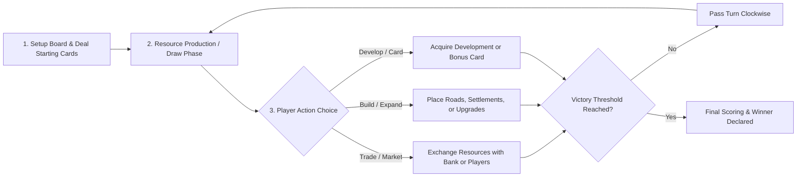

# Architecture & Visual Rule Graph Design — Boardgame Wiki

## 1. High-Level System Architecture

**Boardgame Wiki** is structured into four cohesive domain modules:
1. **Collection & Play Tracker Module**: Manages the personal boardgame catalog, player/time/complexity filtering, play logs, and collection analytics graphs.
2. **Rule Summary & Visual Graph Engine**: Renders structured cheat-sheets alongside interactive turn-structure flowcharts and scoring graphs so friends can learn rules visually.
3. **WhatsApp Sharing Service**: Formats single-game rule summaries, curated game lists, and UAE event cards into WhatsApp-native markdown with instant `wa.me` deep-linking and clipboard export.
4. **UAE Boardgame Events Module**: Tracks tabletop meetups, café nights, tournaments, and conventions across Dubai, Abu Dhabi, and Sharjah.

---

## 2. Visual Rule Graph Architecture (Example Rule Flowcharts)

Each boardgame entry includes a structured **Rule Graph** representing Setup, Turn Phases, Decision Branches, and End-Game Scoring. Below is an example of how a game's turn and scoring flow is modeled visually for friends:

---

## 3. Collection & Play Analytics Graphs

In addition to per-game rule flowcharts, the application generates collection-level graphs:
- **Complexity vs. Playtime Scatter/Distribution Graph**: Helps groups pick between quick filler games (`15–30 min`, weight `< 2.0`) and deep strategy games (`90–150 min`, weight `> 3.0`).
- **Player Count Coverage Matrix**: Shows which games scale best for 2, 3, 4, 5, or 6+ players.
- **Play Session Frequency & Win Breakdown**: Tracks most-played titles and session history across game nights.
