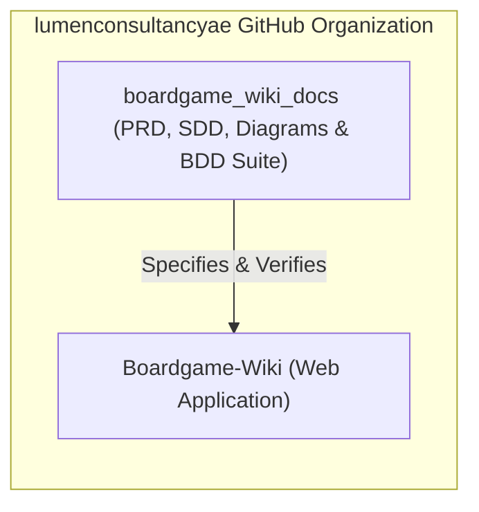
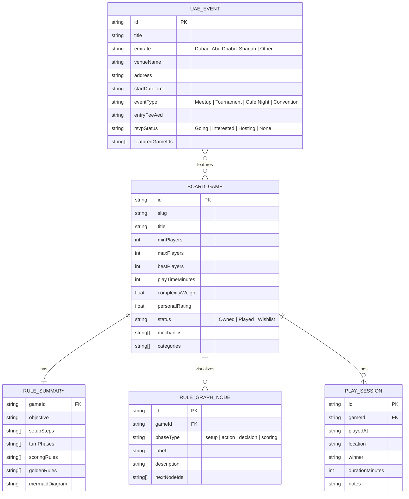

# System Design Document (SDD) — Boardgame Wiki

## 1. Multi-Repository Ecosystem Topology

The project spans two synchronized repositories under the `lumenconsultancyae` GitHub organization:

1. **[`lumenconsultancyae/Boardgame-Wiki`](https://github.com/lumenconsultancyae/Boardgame-Wiki)**: Main web application housing the UI components, domain models, rule graph renderer, WhatsApp formatting engine, and UAE events tracker.
2. **[`lumenconsultancyae/boardgame_wiki_docs`](https://github.com/lumenconsultancyae/boardgame_wiki_docs)**: Companion specification, architectural diagrams, Docker Compose stack, and BDD E2E test suite.

---

## 2. Domain Model & Data Schema

### 2.1 Core Entities

---

## 3. WhatsApp Message Serialization Architecture

The WhatsApp Sharing service (`whatsappFormatter`) transforms domain entities into deterministic, UTF-8 encoded WhatsApp messages using WhatsApp native markdown (`*bold*`, `_italic_`, `~strikethrough~`, monospace blocks) and generates deep links (`https://wa.me/?text=...`):

1. **Single Game Summary Payload**:
   - Header: `🎲 *{title}* ({minPlayers}-{maxPlayers} Players • ⏱ {playTimeMinutes}m • ⚙️ Weight: {complexityWeight}/5)`
   - Objective: `🏆 *Goal:* {objective}`
   - Setup & Turn Flow: Bulleted step list of `setupSteps` and `turnPhases`
   - Golden Rules & Link to Interactive Rule Diagram
2. **Game List / Game Night Shortlist Payload**:
   - Header: `📚 *Boardgame Night Shortlist ({count} Games)*`
   - Filtered summary line per game with player range, playtime, complexity, and 1-line pitch
   - Voting prompt for group chat replies
3. **UAE Event Invite Payload**:
   - Header: `📅 *UAE Boardgame Event: {title}*`
   - Location (`{venueName}, {emirate}`), Date/Time, Entry Fee (AED), Featured Games, and RSVP note.
